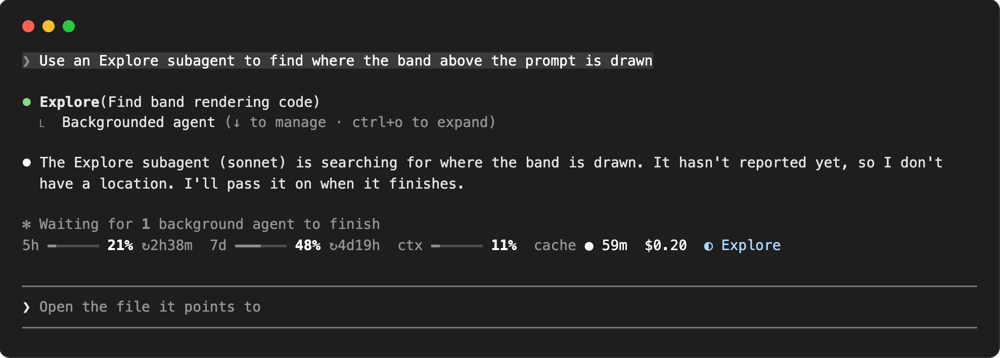

# limits

[](LICENSE)
[](https://claude.com/blog/claude-code-mods)

**Before you send the next prompt, know how much room you have left**: quota, context, prompt cache and money. A Claude Code mod that puts them on one line above the prompt, in the terminal and the desktop app, with details on hover.

<p align="center">
  
</p>

<p align="center">
  <a href="#install">Install</a> · <a href="#what-you-see">What you see</a> · <a href="#configure">Configure</a> · <a href="#make-it-yours">Make it yours</a> · <a href="#what-it-can-reach">What it can reach</a>
</p>

## Install

Inside Claude Code (2.1.287 or later):

```
/plugin marketplace add VaitaR/claude-code-limits
/plugin install limits@claude-code-limits
/reload-plugins
```

<details>
<summary><strong>From a clone</strong></summary>

```sh
git clone https://github.com/VaitaR/claude-code-limits
claude --plugin-dir ./claude-code-limits
```

</details>

Mods are an early-access Claude Code feature and their API can change between releases.

## What you see

<p align="center">
  
</p>

| Segment | Reads | Hover, for example |
| --- | --- | --- |
| **`5h`** **`7d`** | the rate-limit windows your plan reports: how much is used, and `↻` the time to each reset | `5h · 21% used, 79% left · resets 18:07` |
| **`ctx`** | context against the window Claude Code compacts at; `⟲3` after three compactions | `ctx · 31k of 258k tokens · 3 compactions` |
| **`cache`** | `● live` while a turn runs, then `● 59m` the minutes the prompt cache has left, `○ cold` once it expired | `cache · warm until 16:31 (1h TTL)` |
| **`$0.20`** | the session's cost at API prices, subagents included | the last turn's cost; with a [`costCommand`](#configure), the main thread and each subagent a row apiece |
| **`◐ Explore`** | subagents running now: the type of one, `◐ 3 agents` for several | their types |

In the desktop app a hover lists its rows; a terminal shows it as one line, moved left when it would run past the edge.

**Quiet until it matters.** The line stays grey and white while all is well. Colour marks only what needs attention:

| | Amber | Red |
| --- | --- | --- |
| `5h` `7d` | 70% used, or a reset under 5 minutes away | 90% used |
| `ctx` | 60%, and the `⟲N` of compactions | 80% |
| `cache` | under 5 minutes left | cold: the next prompt rewrites the whole cache |

Model, branch, effort and the like are left to the rest of the app. On a narrow window the line wraps whole segments onto a second row rather than cutting one.

## Configure

In `/config`, or under `pluginConfigs["limits"].options` in `settings.json`:

| Option | Default | Meaning |
| --- | --- | --- |
| `cacheTtl` | `1h` | the main loop's prompt-cache lifetime: `1h` with extended caching, `5m` otherwise |
| `palette` | `theme` | `pastel` uses fixed colours tuned for dark terminals |
| `costCommand` | empty | a command printing a session's cost split as JSON, the session id appended; the cost hover then names the main thread and each subagent |

<details>
<summary><strong>The <code>costCommand</code> contract</strong></summary>

The command gets the session id as its last argument and prints one JSON object:

```json
{ "total_usd": 5.85, "main_usd": 5.75, "unpriced_calls": 0,
  "agents": [{ "agent_type": "Explore", "description": "map the repo", "usd": 0.1 }] }
```

The hover then reads, costliest first:

```
session $5.85 at API prices
$5.75 main
$0.10 Explore · map the repo
+$0.42 last turn
```

It runs at session start, at each main turn's end and at each subagent's end, one run at a time, with a 15 s timeout. A failure keeps the last split. The [`customize-limits`](skills/customize-limits/SKILL.md) skill explains how to price a transcript.

</details>

## Make it yours

The plugin ships a skill, **`customize-limits`**. Ask Claude in plain words:

> make the context gauge turn amber at 50%
>
> hide the cost segment
>
> add a segment with the current git branch
>
> wire a costCommand for my sessions

It knows where each threshold, colour, gauge and segment lives, how to add one, how to test the change, and the traps of drawing in a terminal.

## What it can reach

**It only watches.** Every hook passes its event on unchanged: it never denies, rewrites or delays anything.

| It reads | Through |
| --- | --- |
| context, cost and rate-limit readings | `session.measure`, `$.session.usage()` |
| when the main loop's requests are sent and answered | `turn.step` |
| compactions | `session.compact` |
| subagent spawns and ends (type only) | `agent.spawn`, `turn.complete` |
| the tail of this session's transcript, once, when loaded mid-session, to start the cache clock | `sh -c tail -c 400000 ~/.claude/projects/*/<session id>.jsonl` |
| your `costCommand`'s output, if you set one | `$.process.run` |

It makes **no** network requests and calls no model. State lives in session atoms and ends with the session. `claude plugin validate .` prints exactly what it hooks and calls.

## What is inferred, not measured

- **The cache clock** starts when the main loop's last answered request was sent and runs for `cacheTtl`. The engine reports no TTL, so a wrong `cacheTtl` gives a wrong clock.
- **Quotas are account-wide.** Parallel sessions spend the same windows; the band shows the last reading any response carried. A reading without a window keeps the previous one until it resets.
- **Cost is the engine's API-price figure.** On a subscription it is what the session would cost at API prices, not a bill.

## Develop

```sh
claude --plugin-dir .            # load it; edits hot-reload
claude plugin validate .
claude plugin test .
npx -p typescript tsc -p .       # after the first load, which writes .claude-plugin/types/
```

<details>
<summary><strong>Files</strong></summary>

| File | Holds |
| --- | --- |
| [`hooks/register.tsx`](hooks/register.tsx) | the event hooks and the band |
| [`hooks/core.ts`](hooks/core.ts) | config, formatting and readings as pure functions |
| [`hooks/countdown.tsx`](hooks/countdown.tsx) | a surface module: the reset and cache countdowns tick on the surface's own clock |
| [`types/index.d.ts`](types/index.d.ts) | the state contract |
| [`skills/customize-limits/`](skills/customize-limits/SKILL.md) | the skill for tuning and extending the band |

</details>

See [CONTRIBUTING.md](CONTRIBUTING.md). Changes are listed in [CHANGELOG.md](CHANGELOG.md).

## License

[MIT](LICENSE). Started as a fork of [claude-flightdeck](https://github.com/scasella/claude-flightdeck) by Stephen Casella.
