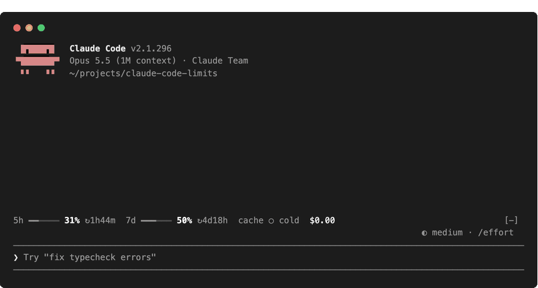
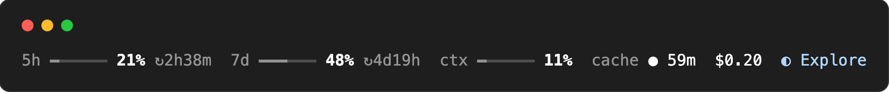
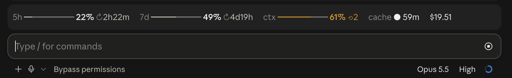

# limits

[](LICENSE)
[](https://claude.com/blog/claude-code-mods)

**Know how much room you have left before the next prompt.** A Claude Code mod that puts your 5h and 7d quota, context, prompt-cache time and session cost on one line above the prompt, with the subagents still running and what you last asked. It works in the terminal and the desktop app; hover a segment for details.

<p align="center">
  
</p>

<p align="center">
  <a href="#install">Install</a> · <a href="#what-you-see">What you see</a> · <a href="#configure">Configure</a> · <a href="#make-it-yours">Make it yours</a> · <a href="#what-it-can-reach">What it can reach</a>
</p>

## Install

Inside Claude Code (2.1.287 or later):

```
/plugin marketplace add VaitaR/claude-code-limits
/plugin install limits@claude-code-limits
/reload-plugins
```

<details>
<summary><strong>From a clone</strong></summary>

```sh
git clone https://github.com/VaitaR/claude-code-limits
claude --plugin-dir ./claude-code-limits
```

</details>

Mods are an early-access Claude Code feature and their API can change between releases.

## What you see

| Terminal |
| --- |
|  |
| **Desktop app** |
|  |

Hovering a segment shows its details: the desktop app lists them as rows, a terminal joins them into one line in a blank row the band keeps under itself, below the segment, or across the segment's row when the band has no row to spare.

| Segment | Shows | Hover, for example |
| --- | --- | --- |
| **`5h`** **`7d`** | how much of each rate-limit window your plan reports is used, and after `↻` the time to its reset | `5h · 21% used, 79% left · resets 18:07` |
| **`ctx`** | context against the window Claude Code compacts at; `⟲3` after three compactions | `ctx · 31k of 258k tokens · 3 compactions` |
| **`cache`** | `● live` while a turn runs, then `● 59m`, the minutes the prompt cache has left (seconds in its last minute), and `○ cold` once it has none | `cache · warm until 16:31 (1h TTL)` |
| **`$0.20`** | the session's cost at API prices, subagents included | `session $0.20 at API prices, subagents included`, then the last turn's cost; with a [`costCommand`](#configure), rows for the main thread and the subagents |
| **`◐ Explore`** | the subagents running now: the type of one, `◐ 3 agents` for several | `1 subagent running`, then per agent its type and task, and a row with how long it has run, its model, its last request's context, its tool calls so far and the latest one: `1m59s · Sonnet 5.5 · 156k ctx · 48 tools · Bash(Find RPC clients)` |
| **`❯ fix the flaky…`** | your last prompt, in the room the line has left and cut with `…`; with less than 40 cells left, on a row of its own when there is room for one | `last prompt · sent 16:18`, then the prompt in full |

**Quiet until it matters.** While all is well the gauges, cache and cost stay in plain text colours. Amber and red mark what needs attention:

| | Amber | Red |
| --- | --- | --- |
| `5h` `7d` | 70% used | 90% used |
| `ctx` | 60%, and the `⟲N` of compactions | 80% |
| `cache` | under 5 minutes left | expired: the next prompt rewrites the cache |

Model, branch, effort and the like are left to the rest of the app. On a narrow window the line moves whole segments to a second row rather than cutting one; only the last prompt is cut to fit.

## Configure

In `/config`, or under `pluginConfigs["limits"].options` in `settings.json`:

| Option | Default | Meaning |
| --- | --- | --- |
| `cacheTtl` | `1h` | the main loop's prompt-cache lifetime: `1h` with extended caching, `5m` otherwise |
| `palette` | `theme` | `theme` follows your Claude Code theme (light, dark, colour-blind); `pastel` uses fixed colours tuned for dark terminals |
| `costCommand` | empty | a command that prints the session's cost split as JSON; it is split on spaces into arguments, without quoting |

<details>
<summary><strong>The <code>costCommand</code> contract</strong></summary>

The command gets the session id as its last argument and prints one JSON object:

```json
{ "total_usd": 5.85, "main_usd": 5.75, "unpriced_calls": 0,
  "agents": [{ "agent_type": "Explore", "description": "map the repo", "usd": 0.1 }] }
```

Only `total_usd` is required; a missing amount counts as zero. The hover lists `agents` in the order given, so print the costliest first: it names the first six and sums the rest into one row, and a non-zero `unpriced_calls` adds a row of its own. For the object above it reads:

```
session $5.85 at API prices
$5.75 main
$0.10 Explore · map the repo
+$0.42 last turn
```

The command runs at session start and at the end of each main turn and each subagent, one run at a time, with a 15 s timeout. A non-zero exit, a timeout or output without `total_usd` keeps the last split. The [`customize-limits`](skills/customize-limits/SKILL.md) skill explains how to price a transcript.

</details>

## Make it yours

The plugin ships a skill, **`customize-limits`**, that knows where each threshold, colour, gauge and segment lives, how to add one and test it, and the traps of drawing in a terminal. Ask Claude in plain words:

> make the context gauge turn amber at 50%
>
> hide the cost segment, or the last prompt while I share my screen
>
> add a segment with the current git branch
>
> wire a costCommand for my sessions

## What it can reach

**It only watches.** No hook denies or rewrites a prompt, a tool call or a subagent; the one drawing hook fills the line above the prompt.

| It reads | Through |
| --- | --- |
| context, cost and rate-limit readings | `session.measure`, `$.session.usage()` |
| when the main loop's requests are sent and answered; a subagent's model and token counts per request | `turn.step` |
| a subagent's tool calls: the tool and the argument that names its target (a Bash call's description or command, a file's name, a search pattern) | `tool.call` |
| the text of your own prompts: typed, from the desktop app or Remote Control, never a notification's or another plugin's | `prompt.submit` |
| compactions | `session.compact` |
| subagent spawns and ends: type, description, model | `agent.spawn`, `turn.complete` |
| the tail of this session's transcript, at session start while no request or prompt has been seen yet, to start the cache clock, show the last prompt Claude Code recorded and the context of the last response | `sh -c tail -c 400000 ~/.claude/projects/*/<session id>.jsonl` |
| the latest 5h/7d readings of every session under the same config directory, and this session's own into it, every 30 s and at each reading | `$.fs` on `<config dir>/state/limits/quota.json` (`CLAUDE_CONFIG_DIR`, else `~/.claude`) |
| your `costCommand`'s output, if you set one | `$.process.run` |

It makes **no** network requests and calls no model; your `costCommand` runs as you wrote it. State lives in session atoms and ends with the session, except the quota file, which holds only the readings of the windows still open. `claude plugin validate .` prints exactly what it hooks and calls.

## What is inferred, not measured

- **The cache clock** starts when the main loop's last answered request was sent and runs for `cacheTtl`. The engine reports no TTL, so a wrong `cacheTtl` gives a wrong clock. A compaction sets the cache to cold.
- **Quotas are account-wide.** Parallel sessions spend the same windows, so every session shows the latest reading any of them received (the hover says when it was read): an idle session lags by up to 30 s behind a busy one, and with no session busy the figure is as old as the last response. A window past its reset is not drawn until the next reading. Sessions share readings through their config directory, so two accounts under two directories never mix.
- **After a restart** (the desktop app stops a hidden session's process after a while idle, and starts it again when you come back) the context gauge shows the transcript's last response until the next one; the compaction count starts from zero.
- **Cost is the engine's API-price figure.** On a subscription it is what the session would cost at API prices, not a bill.

## Develop

```sh
claude --plugin-dir .            # load it; edits hot-reload
claude plugin validate .
claude plugin test .
npx -p typescript tsc -p .       # after the first load, which writes .claude-plugin/types/
```

<details>
<summary><strong>Files</strong></summary>

| File | Holds |
| --- | --- |
| [`hooks/register.tsx`](hooks/register.tsx) | the event hooks and the band |
| [`hooks/core.ts`](hooks/core.ts) | config, formatting and readings as pure functions |
| [`hooks/countdown.tsx`](hooks/countdown.tsx) | a surface module: the reset and cache countdowns tick on the surface's own clock |
| [`types/index.d.ts`](types/index.d.ts) | the state contract |
| [`skills/customize-limits/`](skills/customize-limits/SKILL.md) | the skill for tuning and extending the band |

</details>

See [CONTRIBUTING.md](CONTRIBUTING.md). Changes are listed in [CHANGELOG.md](CHANGELOG.md).

## License

[MIT](LICENSE). Started as a fork of [claude-flightdeck](https://github.com/scasella/claude-flightdeck) by Stephen Casella.
